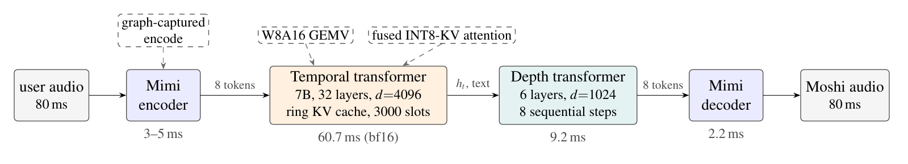
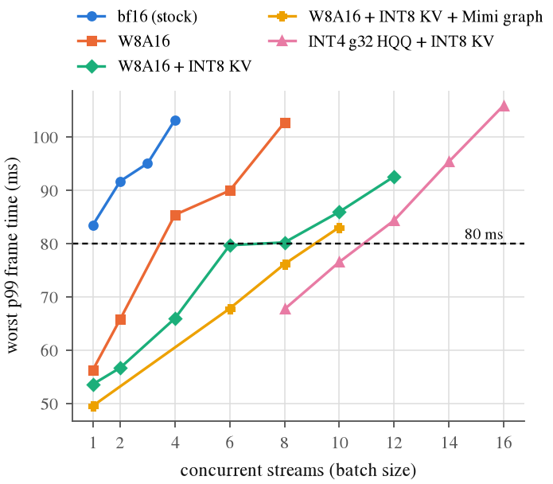
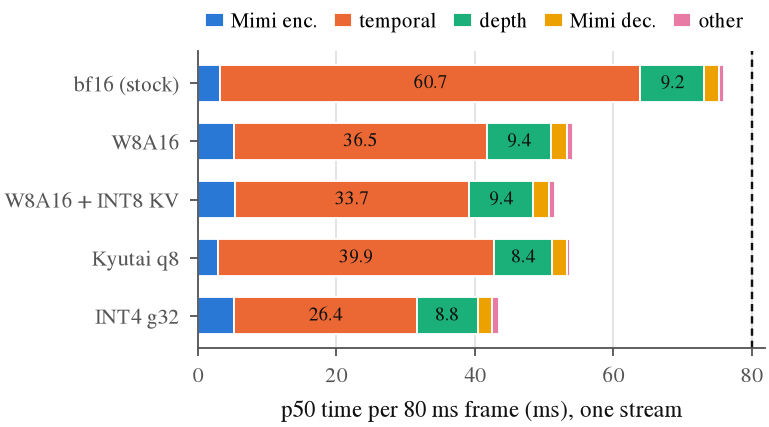
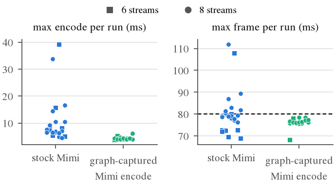
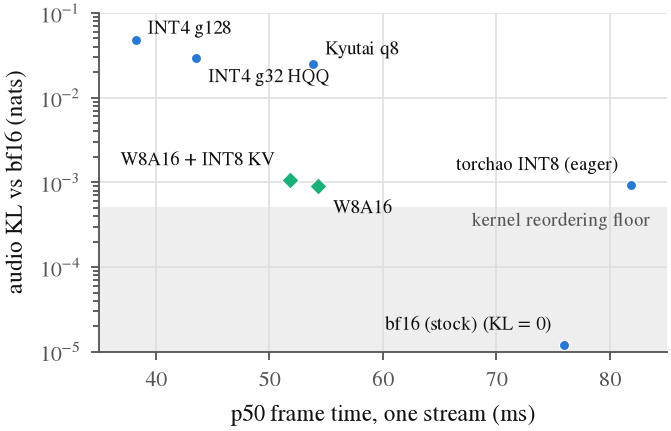

<p align="center">
  <picture>
    <source media="(prefers-color-scheme: dark)" srcset="assets/banner-dark.svg">
    
  </picture>
</p>

<p align="center">
  <a href="LICENSE"></a>
  <a href="https://github.com/kyutai-labs/moshi"></a>
</p>

# moshi-rt

We profile [Moshi](https://github.com/kyutai-labs/moshi), Kyutai's full-duplex speech model, frame by frame on an NVIDIA L4 (24 GB, 72 W). We then change three things so that one GPU serves more concurrent conversations within the 80 ms frame deadline. The repository contains the streaming benchmark, two Triton kernels, a graph-captured Mimi encoder, the teacher-forced quality evaluation, a web app to talk to the model, and one JSON file per measurement in [`results/`](results/).

Moshi's source is not edited; the changes are applied at runtime to the loaded model.

<p align="center">
  
</p>

Every 80 ms the frame runs four stages:
- Mimi encodes 1920 samples of 24 kHz audio into 8 tokens.
- The 7B temporal transformer takes one step over 17 token streams.
- An 8-step depth transformer produces Moshi's 8 audio tokens.
- Mimi decodes the reply.

The dashed boxes mark the three changes.

## Results

| one NVIDIA L4 | bf16 (stock) | INT8 weights + INT8 KV + Mimi graph |
|---|---|---|
| frame time, 1 stream (p50 / worst p99) | 77.2 / 83.4 ms (7 runs) | 48.2 / 49.5 ms (2 runs) |
| late frames, 1 stream | 150 of 12,747 (1.2%) | 0 of 1,821 |
| peak GPU memory, 1 stream | 17.4 GB | 10.4 GB |
| concurrent streams with no late frame | 0 | 8 (0 of 34,599 batch steps, 19 runs) |
| audio KL to bf16, teacher-forced | 0 | 0.0011 |

A late frame is a step longer than 80 ms. In a batch it delays every stream at once, so counts are per batch step.

<p align="center">
  
</p>

The plot shows worst p99 frame time over all runs, paced and back to back, against the number of streams batched through `LMGen`. Capacity depends on how strictly late frames are counted ([`results/capacity.json`](results/capacity.json)):

| streams per L4 | no late frame | ≤ 0.1% late, worst p99 < 80 ms | runs at 8 streams |
|---|---|---|---|
| bf16 (stock) | 0 | 0 | – |
| W8A16 | 2 | 2 | 1 |
| W8A16 + INT8 KV | 2 | 2 | 17 |
| W8A16 + INT8 KV + Mimi graph | 8 | 8 | 19 |
| INT4 g32 + INT8 KV (lower quality) | 8 | 10 | 1 |

## Where the frame goes

<p align="center">
  
</p>

The chart shows per-stage p50 time of one frame for one stream. In the stock bf16 run, the temporal transformer takes 60.7 ms of the 75.9 ms frame:
- **Weights.** It reads 13.15 GB of weights per frame, about 217 GB/s over the stage, or 72% of the L4's 300 GB/s. Its large GEMVs alone run at 247–283 GB/s, depending on how they are measured.
- **Launches.** Moshi already CUDA-graphs the step and `torch.compile`s the small operators. Without graphs a frame takes 207.9 ms, and without compile every frame is late ([`results/ablation_graphs.json`](results/ablation_graphs.json)). What remains is to read fewer bytes per frame and to share each weight read across streams.
- **KV cache.** The cache is scanned in full (3000 slots) at every step, so each stream adds 1.57 GB of reads per frame in bf16.

## The three changes

- **W8A16 GEMV** ([`kernels/w8a16.py`](kernels/w8a16.py)). The temporal transformer's 128 linear layers are stored as INT8 with one scale per output row. A Triton kernel dequantizes tiles in registers and multiplies on tensor cores, with the batch padded to 16 rows. On Moshi's weight shapes it streams INT8 at 214–251 GB/s, 1.73–1.93× faster than cuBLAS bf16 per shape ([`results/kernel_w8a16.json`](results/kernel_w8a16.json)).
- **Fused ring attention with INT8 KV** ([`kernels/kv_attn.py`](kernels/kv_attn.py)). Split-K decode attention over Moshi's ring cache. Slot validity is computed in the kernel. Keys and values are INT8 with a scale per token and head, which cuts the cache from 1.57 to 0.81 GB per stream. Its output differs from Moshi's `RingKVCache` + SDPA by at most 0.031. With a full ring it is 1.54–1.92× faster ([`results/kernel_kv_attn.json`](results/kernel_kv_attn.json)).
- **Graph-captured Mimi encoder** ([`bench/mimi_graph.py`](bench/mimi_graph.py)). Mimi's downsampling convolution and residual quantizer run eagerly, and their kernel launches wait on the host CPU. Of the 224 late frames we logged per stage, 219 coincided with such an encode stall. We capture both in a CUDA graph. That required one streaming-convolution flag to be updated in place. Codes are identical to the stock encoder over 120 frames that include a stream reset ([`results/mimi_graph_check.json`](results/mimi_graph_check.json)).

<p align="center">
  
</p>

The plot shows maximum encode time and maximum frame time per run at six and eight streams. With the stock encoder, 10 of 25 runs had late frames; with the graph-captured encoder, 0 of 21 did.

## Quantization and quality

Quality is measured by teacher forcing:
- A bf16 token stream is replayed through each variant.
- The next-token distributions of the 8 audio codebooks are compared with bf16 over 1500 steps.
- Our attention kernel on a bf16 cache, which differs from SDPA only in summation order, already gives a KL of 0.0005. We use that as the practical floor.

| one stream, one run each | frame p50 / p99 (ms) | peak GB | audio top-1 | audio KL |
|---|---|---|---|---|
| bf16 (stock) | 75.9 / 79.8 | 17.4 | 100% | 0 |
| torchao INT8 weight-only, eager | 81.8 / 83.3 | 10.9 | 98.49% | 0.0009 |
| Kyutai q8 checkpoint (bitsandbytes)¹ | 53.8 / 54.8 | 16.5 | 93.15% | 0.025 |
| INT4 g32 HQQ (tinygemm) | 43.6 / 45.1 | 8.4 | 93.12% | 0.030 |
| W8A16 | 54.3 / 56.3 | 11.1 | 98.62% | 0.0009 |
| W8A16 + INT8 KV | 51.8 / 53.6 | 10.4 | 98.55% | 0.0011 |

¹ `moshi` 0.2.13 casts this checkpoint's float32 INT8 scales to bf16 and fails at the first forward pass; [`quant/int8.py`](quant/int8.py) loads it with float32 scales. Its peak drops to 10.1 GB when the skeleton is built on the CPU.

Single runs on different hosts differ by a few milliseconds in Mimi encode, so compare the temporal stage (60.7 ms bf16, 39.9 ms q8, 36.5 ms W8A16) rather than the frame medians.

The two INT8 options behave differently. torchao's INT8 is slower than bf16 in eager mode because it materializes bf16 weights, and its compiled path recompiles inside Moshi's graph-captured loop. Over one 3200-step call that fills and wraps the KV ring, W8A16 + INT8 KV stays at KL 0.0008 in the last 800 steps ([`results/quality_long_w8triton_kv-int8.json`](results/quality_long_w8triton_kv-int8.json)).

<p align="center">
  
</p>

The plot shows frame time against audio KL to bf16. The grey band is the summation-order floor.

## Talk to it

```bash
git clone https://github.com/aryawidjaja/moshi-rt && cd moshi-rt
./start.sh            # or: ./start.sh --stock  to compare with stock bf16
```

`start.sh` runs the model on a local NVIDIA GPU if there is one. Otherwise it starts a temporary L4 on your own [Modal](https://modal.com) account, which asks you to log in the first time. Either way it opens a call page on `localhost` with:
- live captions;
- per-frame model time against the 80 ms line;
- rolling p50 and p99, late frames, and the network round trip, shown separately from model time.

The first start downloads the weights (about 15 GB) into a Modal Volume, which takes a few minutes. Ctrl-C stops the app, and the cloud GPU is released when the command exits. Use headphones: the model hears everything your microphone picks up.

## Requirements

An NVIDIA GPU with bf16 tensor cores (sm80 or newer). Tested with Python 3.12, PyTorch 2.9.1 (CUDA 12.8), Triton 3.5.1 and `moshi` 0.2.13 on an L4.

## Reproducing the results

The commands run on a Modal L4; [`scripts/remote.sh`](scripts/remote.sh) runs them on a Colab session instead.

```bash
pip install modal && modal setup

# test clips (LibriSpeech test-clean) and the bf16 baseline
modal run bench/modal_app.py --cmd "python scripts/make_clips.py && python bench/stream_bench.py --tag bf16_b1"

# eight streams with all three changes, paced like live audio
modal run bench/modal_app.py --cmd "python bench/stream_bench.py --quant w8triton --kv int8 --graph-mimi --batch 8 --paced --tag w8kv8_b8"

# kernel and encoder correctness tests
modal run bench/modal_app.py --cmd "python kernels/w8a16.py && python kernels/test_kv_attn.py && python bench/mimi_graph.py"

# teacher-forced quality
modal run bench/modal_app.py --cmd "python quant/teacher_force.py --record && python quant/teacher_force.py --quant none && python quant/teacher_force.py --quant w8triton --kv int8"

# summaries and figures from results/
python scripts/summarize_streams.py && python scripts/summarize_quant.py && python scripts/paper_figures.py
```

## Code

```
app/       web app: real-time server, browser client, Modal wrapper, websocket test client
bench/     streaming benchmark (moshi.server's per-frame path), profiler, Mimi graph capture, Modal runner
kernels/   W8A16 GEMV and fused ring-KV attention (Triton), with tests and microbenchmarks
quant/     INT8 / INT4 / q8 loaders and the teacher-forced quality evaluation
scripts/   test clips, summaries, figures, Colab runner
results/   one JSON per run, with GPU, driver, package versions, commit and command line
profiles/  profiler summaries
audio/     the five test clips and their sources
```

## Limitations

- We study one model on one GPU type, and only its PyTorch implementation.
- The clips are read speech, and quality is measured by teacher forcing rather than by listeners.
- Streams start together and stay for the whole run; the server path, network and Opus coding are not part of the benchmark.
- Run counts differ between configurations (1 to 19).
- The kernels need sm80+ and were not tested on a 16 GB card. The 16 GB result comes from an allocator cap on the L4.

## Acknowledgements

Moshi and Mimi are the work of [Kyutai](https://kyutai.org); the model weights are released under CC BY 4.0 and the code under MIT. The test clips are derived from [LibriSpeech](https://www.openslr.org/12) (CC BY 4.0).

## Citation

```bibtex
@software{aryawijaya2026moshirt,
  author = {Aryawijaya, Mutaqin},
  title  = {moshi-rt: profiling and serving Moshi in real time on one GPU},
  year   = {2026},
  url    = {https://github.com/aryawidjaja/moshi-rt}
}
```

Please also cite Moshi:

```bibtex
@article{defossez2024moshi,
  title   = {Moshi: a speech-text foundation model for real-time dialogue},
  author  = {D{\'e}fossez, Alexandre and Mazar{\'e}, Laurent and Orsini, Manu and Royer, Am{\'e}lie and
             P{\'e}rez, Patrick and J{\'e}gou, Herv{\'e} and Grave, Edouard and Zeghidour, Neil},
  journal = {arXiv preprint arXiv:2410.00037},
  year    = {2024}
}
```
